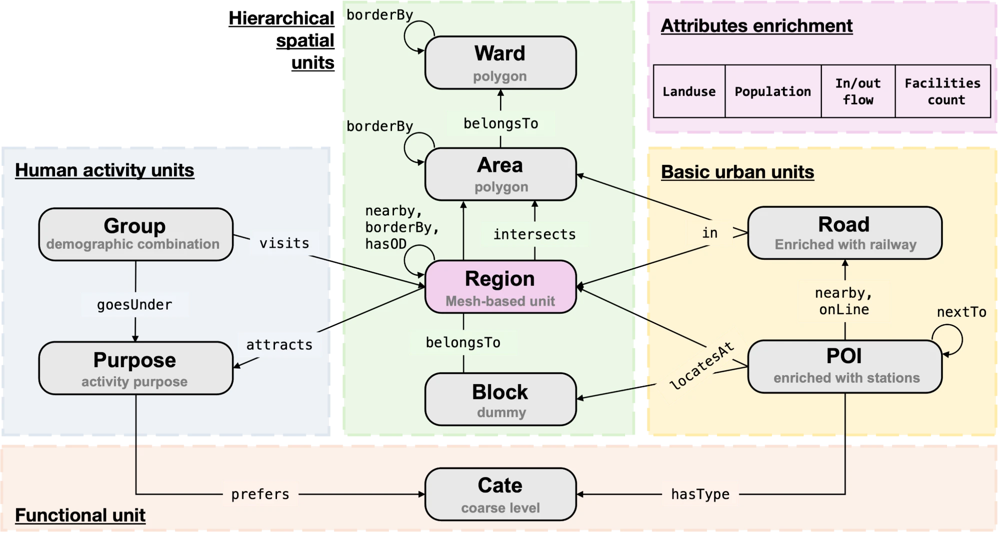

# UnifiedUKG: Unified Urban Knowledge Graph Construction

UnifiedUKG builds an urban knowledge graph (UKG) for Japanese cities from
administrative boundaries, standard grid meshes, roads and railways, POIs,
land use, population and human mobility data. It merges three earlier UKG
pipelines into one schema and one code base:

* **Foundation UKG** (GUFM): administrative hierarchy, meshes, roads, railways and stations, POIs.
* **DCM-UrbanKG**: travel purposes, demographic groups, OD flows and Region attributes.
* **UrbanRAG+ UKG**: the address hierarchy (POI → Block → Area → Ward) and POI–Road proximity.

The repository ships a small sample (`data_sample/`) and the UKG built from it
(`ukg_sample/`). The build runs end to end on the sample in a few seconds.



## Schema at a glance

**9 entity types** in 4 layers, **21 relation types** (14 relation names) and
**26 Region attributes**. See [docs/SCHEMA.md](docs/SCHEMA.md) for the
construction rule of every element.

| Layer | Entities |
|---|---|
| Hierarchical spatial units | `Ward` (polygon), `Area` (town / chōme polygon), `Region` (1/2 mesh, ~500 m), `Block` (address unit, no geometry) |
| Basic urban units | `Road` (roads + railway lines), `POI` (Zenrin POIs, schools, stations) |
| Human activity units | `Group` (age × sex × job), `Purpose` (activity purpose) |
| Functional unit | `Cate` (14 coarse POI categories) |

| Relation | (Head, Tail) |
|---|---|
| `borderBy` | (Ward, Ward), (Area, Area), (Region, Region) |
| `belongsTo` | (Area, Ward), (Block, Area) |
| `intersects` | (Region, Area) |
| `nearby` | (Region, Region), (POI, Road), (POI[station], Region) |
| `hasOD` | (Region, Region) |
| `in` | (Road, Area), (Road, Region) |
| `locatesAt` | (POI, Region), (POI, Block) |
| `onLine` | (POI[station], Road[railway]) |
| `nextTo` | (POI[station], POI[station]) |
| `hasType` | (POI, Cate) |
| `prefers` | (Purpose, Cate) |
| `goesUnder` | (Group, Purpose) |
| `visits` | (Group, Region) |
| `attracts` | (Region, Purpose) |

Region attributes (attribute enrichment): land-use shares (9), population,
inflow and outflow, and POI counts per category (14).

## Repository layout

```text
UnifiedUKG/
├── configs/
│   ├── setagaya_sample.yaml      # builds the bundled sample
│   └── tokyo23.example.yaml      # template for full data
├── data_sample/                  # raw-format input sample (see data_sample/README.md)
│   ├── administrative/           # N03 wards, e-Stat towns
│   ├── road/                     # DRM roads (synthetic), railway lines, railway LOD JSON
│   ├── poi/                      # Zenrin (synthetic), P29 schools, railway stations
│   ├── landuse/  population/     # L03-b-u 100 m land use, 500 m mesh population
│   └── mobility/                 # Softbank OD, GPS trips, survey (all synthetic)
├── ukg_sample/setagaya/          # UKG built from data_sample
│   ├── tables/                   # canonical node / edge / literal CSVs
│   ├── text/                     # KGE text format (entity2id, triplets, train/valid/test, ...)
│   └── build_report.json
├── unified_ukg/                  # the package
│   ├── schema.py                 # entities, relations, vocabularies (single source of truth)
│   ├── loaders.py                # raw source readers
│   ├── builders/                 # spatial, urban, attributes, activity
│   ├── export/                   # text.py (KGE format), neo4j.py (Neo4j loader)
│   ├── graph.py  pipeline.py  config.py  __main__.py
│   └── utils/                    # mesh codes, address parsing, geometry
├── tools/make_data_sample.py     # how data_sample/ was produced
├── tests/
└── docs/SCHEMA.md
```

## Quick start

```bash
pip install -r requirements.txt
python -m unified_ukg build --config configs/setagaya_sample.yaml
```

The command writes `ukg_sample/setagaya/{tables,text,build_report.json}`. Check
the result with:

```bash
python -m unified_ukg stats --tables ukg_sample/setagaya/tables
python -m pytest
```

### Load into Neo4j

Copy `.env.example` to `.env`, fill in the connection settings, then:

```bash
python -m unified_ukg neo4j --tables ukg_sample/setagaya/tables --dry-run   # show the plan
python -m unified_ukg neo4j --tables ukg_sample/setagaya/tables --database neo4j
```

The loader creates a uniqueness constraint on `id` for every label and writes
with `MERGE`, so running it again does not duplicate anything. Region
attributes become Region properties; POIs also get a `location` point.

### Export the KGE text format only

```bash
python -m unified_ukg text --tables ukg_sample/setagaya/tables --out my_text [--typed-relations]
```

## Output formats

**`tables/`** holds the canonical representation that both exporters read:

| File | Content |
|---|---|
| `nodes/<Type>.csv` | one row per entity; `id` is unique within the type; `geometry` is WKT (EPSG:4326); list columns are JSON |
| `edges/<Head>__<rel>__<Tail>.csv` | `head_id, tail_id` plus edge properties; symmetric relations are stored in both directions |
| `literals.csv` | `label, id, attribute, value` (Region attributes) |
| `schema_stats.csv`, `summary.json` | counts per relation type and per entity type |

**`text/`** follows the UUKG / DCM-UrbanKG convention. An entity is written as
`<Type>/<id>`, e.g. `Region/533935931` or `POI/station_9a1ade59258a`.

| File | Format |
|---|---|
| `entity2id.txt`, `relation2id.txt` | `name<TAB>id` |
| `UrbanKG.txt` | `head relation tail` (names) |
| `triplets.txt`, `train.txt`, `valid.txt`, `test.txt` | `head_id relation_id tail_id`; 90 / 5 / 5 split, seed 2026 |
| `literal.txt` | `entity attribute value` |
| `literal_schema.json` | attribute order and the origin / destination attribute groups |

## Sample UKG (`ukg_sample/setagaya`)

The 3 × 3 half meshes around Shimokitazawa (Setagaya / Shibuya / Meguro).

| Entities | Count | | Relation type | Count |
|---|---:|---|---|---:|
| Ward | 3 | | Ward borderBy Ward | 6 |
| Area | 23 | | Area belongsTo Ward | 23 |
| Region | 9 | | Area borderBy Area | 110 |
| Block | 39 | | Block belongsTo Area | 39 |
| Road | 51 | | Region intersects / borderBy / nearby / hasOD | 49 / 40 / 72 / 39 |
| POI | 53 | | Road in Area / Region | 107 / 82 |
| Group | 26 | | POI locatesAt Region / Block | 53 / 48 |
| Purpose | 7 | | POI nearby Road / Region | 14 / 26 |
| Cate | 14 | | POI onLine Road, POI nextTo POI | 6 / 8 |
| **Total** | **225** | | POI hasType Cate, Purpose prefers Cate | 61 / 15 |
| | | | Group goesUnder Purpose / visits Region | 83 / 82 |
| | | | Region attracts Purpose | 18 |
| | | | **Total triples** | **981** |

Plus 234 Region literals (9 Regions × 26 attributes). The Zenrin, DRM, OD, GPS
and survey parts of the sample are synthetic, so the sample graph is only meant
to show formats and every construction step, not to be analysed.

## Using full data

1. Copy `configs/tokyo23.example.yaml` and point every `sources` entry at your
   files. Column names follow the original providers; override them with a
   `columns:` map when your files differ (see `unified_ukg/loaders.py`,
   `DEFAULT_COLUMNS`).
2. Choose the study area with `study_area.wards` (municipality codes) or
   `study_area.meshes` (1/2 mesh codes).
3. Leave out the sources you do not have. The relations that depend on them are
   skipped. For example, without `od`, `trips` and `survey` there is no
   human-activity layer.

The proprietary datasets (Zenrin POI, DRM, Softbank OD, GPS / survey) are not
redistributable. Obtain them from the providers.

## Main construction rules

* **Region** cells are generated from 9-digit mesh codes on an exact integer
  grid. `borderBy` is the 8-neighbourhood. `nearby` links Regions whose
  centroids are within 3 km (metric CRS EPSG:32654).
* **Block** is parsed from POI addresses (`pref city town [N丁目] block`) and
  has no geometry: no free block polygon data exists, and a centroid would
  misrepresent a polygon unit. If an address omits 丁目 but the town is split
  into chōme, the first number is read as the chōme.
* **Stations**: per-line station points with the same name within 500 m are
  merged into one POI. `onLine` and `nextTo` follow the station order of the
  railway LOD (山手線 is closed as a loop). Stations missing from the study area
  are skipped and never bridged.
* **POI nearby Road**: the nearest non-railway road within 20 m, for every POI,
  with `distance_m`.
* **Categories**: Zenrin BUSC code ranges (GUFM version, multi-label where
  ranges overlap). Schools → School, stations → Transportation; Zenrin
  transport rows (PTYPE 22) are dropped in favour of the station source.
* **Group** = age group (6) × sex (2) × job (9) = 108 groups. The ids reproduce
  the DCM numbering.
* **Region attracts Purpose**: a land-use type with a share ≥ 0.2 maps to purposes.

## Citation and license

Add the citation of the accompanying paper and the license of the code here.
Data in `data_sample/` keep the terms of their providers. See
[data_sample/README.md](data_sample/README.md).
